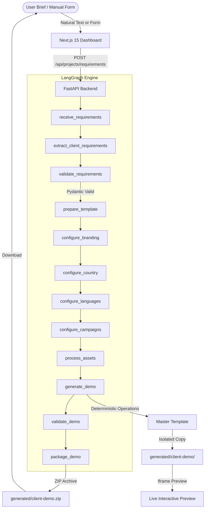

# AI-Powered Client Demo Generator

LangSmith tracing is implemented for chat, Groq usage, agent decisions, generation,
validation, configuration edits, and preview/download actions. See the
[LangSmith setup and usage guide](docs/langsmith.md) for configuration, trace navigation,
cost tracking, and troubleshooting. Verify delivery with
`uv run python -m backend.check_tracing`.

## v3.0: conversational demo agent

The home page is now a chat workspace. The Groq agent collects client details,
asks follow-up questions, drafts branding, homepage copy and campaigns, and selects
whether to ask, update the configuration, or run the LangGraph generation workflow.
The existing master template remains the renderer; this version generates structured
content and configuration rather than arbitrary website source code.

1. Set `GROQ_API_KEY` in the root `.env`. Optionally set
   `GROQ_MODEL=openai/gpt-oss-120b` to select another Groq-supported chat model.
2. Start the backend with `uv run uvicorn backend.main:app --reload` and the frontend
   with `cd frontend` then `npm run dev`. Restart the backend after changing `.env`.
   Docker Compose also passes `.env` to the backend.
3. Describe the client, platform name and country. Attach a logo, homepage image,
   or an image for an existing campaign using the image-purpose selector, then send.
4. Ask the agent to generate the demo, or use **Generate demo** once the required
   details are present. The generated site appears alongside the conversation.
5. Continue chatting to revise details, or open **Edit details** for the existing
   branding, country, homepage and campaign forms. Save back to chat and rebuild,
   or generate directly from the editor. Each build gets its own preview and ZIP.

Conversations and original uploaded image data are persisted in
`uploads/conversations/`, outside the downloadable demo. The browser remembers the
latest conversation ID and restores it on reload, including after backend restarts.
Images are stored locally and applied to the site; the text model receives image
references rather than image bytes and does not visually analyze them. Client text
and configuration are sent to Groq to process the conversation. **New demo** starts
a fresh conversation and retains previous files on disk.

The agent output is validated against `ClientConfig`, and invalid JSON/schema or
unavailable image references get one correction attempt. Provider failures are
shown in the chat without replacing the saved configuration. Manual edits remain
available after generation. Changed details show a rebuild reminder above the preview.

Chat API: `POST /api/conversations`, `GET /api/conversations/{id}`,
`POST /api/conversations/{id}/messages`, `PUT /api/conversations/{id}/config`,
and `POST /api/conversations/{id}/generate`. Earlier generation APIs remain available.

Validation: `uv run pytest tests -q`, `node --test tests/client-branding.test.cjs`,
and, inside `frontend`, `npx tsc --noEmit`, `npm run lint`, `npm run build`.
The conversation tests mock Groq and cover persistent state, attachment preservation,
revision/rebuild, invalid input, invalid model output and provider failure handling.

An end-to-end agentic application that transforms a **Master Demo Template** into customized, client-branded interactive demo websites using **Python, FastAPI, LangGraph, Pydantic, and Next.js**.

---

## 1. Core Principle

$$\text{Master Template} + \text{Structured ClientConfig} + \text{LangGraph Orchestration} = \text{Customized Client Demos}$$

Rather than rebuilding client demo websites from scratch, this system maintains a reusable, feature-rich Master Demo Template and applies client branding, custom country/regional data, multi-language localization (`locales/*.json`), dynamic campaign structures, and media assets safely and deterministically.

---

## 2. Architecture Overview



---

## 3. Technology Stack

- **Backend**: Python 3.13, FastAPI, LangGraph, Pydantic v2, Uvicorn, Pytest
- **Frontend**: Next.js 15 (App Router), TypeScript, Tailwind CSS, Lucide React
- **Master Template Engine**: Pure HTML5, Vanilla CSS (CSS Custom Properties), JavaScript (ES6+), Client i18n engine (`locales/*.json`)
- **LLM Integration**: Groq Chat Completions with validated JSON configuration updates and conversational generation decisions

---

## 4. Project Structure

```text
lkq-ecp-sherbet-demo/
├── master-template/           # Master Demo Template
│   ├── index.html
│   ├── campaigns.html
│   ├── trade-rewards.html
│   ├── brake-focus.html
│   ├── varta-power-days.html
│   ├── league.html
│   ├── dashboard.html
│   ├── points-bank.html
│   ├── shop.html
│   ├── voucher-wallet.html
│   ├── sherbot.html
│   ├── help.html
│   ├── assets/
│   │   ├── config.js          # Central CLIENT_CONFIG definition
│   │   ├── i18n.js            # Dynamic localization engine
│   │   ├── app.css            # Dynamic CSS variables (--blue, --citrus, --black)
│   │   ├── app.js             # Shared chrome & campaign rail renderer
│   │   └── data.js            # Dynamic demonstration figures
│   └── locales/               # Generated language dictionaries
│       ├── en.json
│       ├── ro.json
│       ├── fr.json
│       ├── de.json
│       ├── es.json
│       └── ar.json
│
├── backend/                   # Python FastAPI + LangGraph Backend
│   ├── main.py                # Server entrypoint
│   ├── models/                # Pydantic ClientConfig schemas
│   ├── services/              # Template, Asset, i18n, Validation & Packaging services
│   ├── generator/             # Deterministic generate_demo engine
│   ├── agents/                # LangGraph state & node orchestration
│   └── api/                   # FastAPI route endpoints
│
├── frontend/                  # Next.js Dashboard Application
│   ├── app/                   # App Router (page.tsx, layout.tsx)
│   ├── components/            # Dashboard, PreviewModal, Brand forms
│   └── types/                 # TypeScript interfaces
│
├── generated/                 # Isolated generated client demos
├── tests/                     # Automated Pytest suite
├── .env.example               # Environment variable schema
└── README.md
```

---

## 5. Setup & Running Instructions

### Prerequisites
- **Python 3.10+** (Python 3.13 installed)
- **Node.js 18+** & `npm`

### 1. Backend Server Setup
```bash
# Install dependencies if needed
pip install fastapi uvicorn pydantic langgraph pytest python-dotenv

# Start FastAPI backend server
python -m uvicorn backend.main:app --host 0.0.0.0 --port 8000 --reload
```
Backend API will run at `http://localhost:8000`.

### 2. Frontend Dashboard Setup
```bash
cd frontend
npm install
npm run dev
```
Open `http://localhost:3000` in your browser to access the **AI-Powered Client Demo Generator** dashboard.

---

## 6. How ClientConfig Works

All client customization flows through a structured JSON schema (`ClientConfig` Pydantic model):

```json
{
  "clientName": "Renault",
  "platformName": "Pulse",
  "tagline": "Driven by Passion",
  "defaultLanguage": "en",
  "branding": {
    "logo": "assets/client/logo.svg",
    "primaryColor": "#000000",
    "secondaryColor": "#1a1a1a",
    "accentColor": "#FFD200"
  },
  "country": {
    "code": "RO",
    "name": "Romania",
    "currency": "RON",
    "symbol": "RON",
    "pointsRatio": 100
  },
  "countryConfig": {
    "country": "Romania",
    "regions": ["Bucharest", "Transylvania", "Moldavia", "Banat"],
    "branches": ["Bucharest Central", "Cluj-Napoca", "Timișoara", "Iași"],
    "defaultBranch": "Bucharest Central"
  },
  "languages": [
    { "code": "en", "label": "English" },
    { "code": "ro", "label": "Română" }
  ],
  "campaigns": [
    {
      "id": "sales-challenge",
      "name": "Renault Sales Challenge",
      "type": "Hit & Win Incentive",
      "img": "assets/img/photo-goods-to-person.jpg",
      "blurb": "Earn bonus RON points during the summer sales push.",
      "status": "Active"
    }
  ]
}
```

---

## 7. How to Add Another Configurable Field

To add a new configurable field (e.g. `supportPhoneNumber`):

1. **Update Pydantic Model** (`backend/models/client_config.py`):
   Add field to `ClientConfig` class.
2. **Update Master Template Configuration** (`master-template/assets/config.js`):
   Add default value in `window.CLIENT_CONFIG`.
3. **Update UI / Frontend** (`frontend/components/Dashboard.tsx`):
   Add form input element bound to `config.supportPhoneNumber`.
4. **Update Template JS/HTML**:
   Reference `window.CLIENT_CONFIG.supportPhoneNumber` in `app.js` or `index.html`.

---

## 8. Running Automated Tests

Run the comprehensive Pytest verification suite:

```bash
python -m pytest tests/test_generator.py -v
```

Tests cover:
- Pydantic schema validation
- Safe template copying (preventing master template overwrites)
- Asset path sanitization & traversal prevention
- Localization (`locales/*.json`) dictionary generation
- Validation pass (missing assets, broken links, leftover brand strings)
- Standalone ZIP archive packaging
- End-to-end demo generation flow
